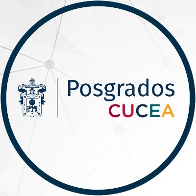

<p align="center">
  <a href="https://posgrados.cucea.udg.mx/">
    
  </a>
  &nbsp;&nbsp;
  <a href="https://mcd.cucea.udg.mx/">
    
  </a>
</p>

# Programación I: Desafíos 1 al 6 y práctica de la Unidad 3

Colección de ejercicios en Python para practicar cadenas, ciclos, estructuras de datos, funciones y manejo de archivos. Los desafíos se ejecutan desde la terminal. La práctica de la Unidad 3 está disponible como script de Python y como notebook de Jupyter.

## Requisitos

- Python 3.
- Una terminal o un editor con soporte para Python.
- Para el desafío 6, un archivo de texto con codificación UTF-8.
- Para la práctica de la Unidad 3, Matplotlib para generar la gráfica.

Los desafíos 1 al 6 utilizan únicamente la biblioteca estándar de Python.

## Archivos

| Ejercicio | Tema | Archivo |
| --- | --- | --- |
| Desafío 1 | Palíndromos | [Desafio_I_Palindromos.py](Desafio_I_Palindromos.py) |
| Desafío 2 | Generador de histograma | [Desafio_II_Histogramas.py](Desafio_II_Histogramas.py) |
| Desafío 3 | Administrador de contactos | [Desafio_III_Contactos.py](Desafio_III_Contactos.py) |
| Desafío 4 | Funciones `map`, `filter` y `reduce` propias | [Desafio_IV_Funciones.py](Desafio_IV_Funciones.py) |
| Desafío 5 | Composición de funciones | [Desafio_V_Composicion.py](Desafio_V_Composicion.py) |
| Desafío 6 | Contador de palabras | [Desafio_VI_Contador_Palabras.py](Desafio_VI_Contador_Palabras.py) |
| Práctica de la Unidad 3 | Limpieza y validación de datos textuales | [Notebook](Seimandi_Unidad3.ipynb) · [Script de Python](unidad3.py) |

El desafío 6 incluye el texto de entrada [Texto_desafio6.txt](Texto_desafio6.txt) y el resultado [Texto_desafio6_estadisticas.txt](Texto_desafio6_estadisticas.txt).

## Ejecución

Abre una terminal en la carpeta `Desafios` y ejecuta el archivo correspondiente. Por ejemplo:

```powershell
python Desafio_I_Palindromos.py
```

En Windows también puedes utilizar `py` en lugar de `python`.

## Desafío 1: Palíndromos

**Objetivo:** determinar si una palabra o frase se lee igual en ambos sentidos, ignorando espacios, signos de puntuación y diferencias entre mayúsculas y minúsculas.

**Solución:** la clase `Validador_Palindromos` utiliza dos índices que recorren la cadena desde los extremos hacia el centro. El método `alfanum` identifica letras y números mediante `isalnum()`, y `esPalindromo` compara los caracteres válidos en minúsculas. Si encuentra una diferencia, devuelve `False`. Si completa el recorrido, devuelve `True`.

```powershell
python Desafio_I_Palindromos.py
```

Ejemplo de uso:

```text
Escribe una frase: Anita lava la tina
Es palíndromo
```

Las tildes se conservan durante la comparación. Una entrada vacía o formada únicamente por signos se considera un palíndromo según la lógica implementada.

## Desafío 2: Generador de histograma

**Objetivo:** representar cantidades mediante barras de asteriscos en la consola.

**Solución:** el programa solicita la cantidad de registros y captura conceptos con sus cantidades. Después valida los datos y genera una barra horizontal por concepto usando la expresión `'*' * int(cant)`.

```powershell
python Desafio_II_Histogramas.py
```

Ejemplo de entrada:

```text
Cantidad de registros: 2
Concepto y cantidad: leones 3
Concepto y cantidad: tigres 5
```

Barras generadas:

```text
leones   ***
tigres   *****
```

También se pueden ingresar varios pares en una misma línea separados por comas, por ejemplo, `leones 3, tigres 5`. La cantidad de registros indica cuántas líneas se solicitarán.

Los conceptos deben escribirse sin espacios y las cantidades deben ser enteros no negativos. El cero genera una barra vacía. Si se ingresa un dato inválido, el programa reinicia toda la captura. La cantidad de registros debe ser mayor que cero.

## Desafío 3: Administrador de contactos

**Objetivo:** administrar contactos con nombre, teléfono y correo electrónico mediante funciones y estructuras de datos.

**Solución:** una lista almacena los contactos, cada contacto se representa con un diccionario y una tupla reúne los datos capturados antes de crear el diccionario. Las operaciones se organizan en funciones independientes.

```powershell
python Desafio_III_Contactos.py
```

El menú ofrece las siguientes opciones:

1. Agregar un contacto.
2. Ver la lista de contactos.
3. Buscar un contacto por nombre.
4. Eliminar un contacto por nombre.
5. Salir.

Se rechazan campos vacíos. La búsqueda y la eliminación comparan el nombre completo sin distinguir mayúsculas y minúsculas. Si hay nombres repetidos, la búsqueda muestra todas las coincidencias y la eliminación borra la primera.

Los contactos permanecen en memoria y se pierden al cerrar el programa. El teléfono y el correo se guardan como texto sin validar su formato.

## Desafío 4: Funciones map, filter y reduce propias

**Objetivo:** implementar funciones que reciban otra función y una lista para transformar, filtrar o acumular sus elementos.

**Solución:** se utilizan ciclos `for` y listas para construir los resultados.

- `mi_map(funcion, lista)` aplica la función a cada elemento y devuelve una nueva lista.
- `mi_filter(funcion, lista)` devuelve una lista con los elementos que cumplen la condición.
- `mi_reduce(funcion, lista, valor_inicial)` acumula un resultado desde el valor inicial y lo devuelve dentro de una lista, siguiendo el requisito de retornar un iterable.

```powershell
python Desafio_IV_Funciones.py
```

La demostración utiliza la lista `[1, 2, 3, 4, 5]`.

| Operación | Resultado |
| --- | --- |
| Duplicar cada número con `mi_map` | `[2, 4, 6, 8, 10]` |
| Conservar los pares con `mi_filter` | `[2, 4]` |
| Sumar desde cero con `mi_reduce` | `[15]` |

Con una lista vacía, `mi_map` y `mi_filter` devuelven `[]`, mientras que `mi_reduce` devuelve `[valor_inicial]`.

## Desafío 5: Composición de funciones

**Objetivo:** crear una función `componer` que reciba una lista de funciones y devuelva una nueva función que encadene sus operaciones.

**Solución:** `componer(funciones)` define y devuelve una función interna llamada `funcion_compuesta`. Al ejecutarla, recorre las funciones en el orden de la lista y utiliza el resultado de cada una como entrada de la siguiente.

```powershell
python Desafio_V_Composicion.py
```

La demostración aplica las funciones `sumar_tres`, `duplicar` y `elevar_al_cuadrado` al número `5`.

```text
5 -> 8 -> 16 -> 256
```

El resultado final es `256`. Cada función debe recibir un argumento y devolver un valor compatible con la siguiente. Si la lista de funciones está vacía, se devuelve el valor original.

## Desafío 6: Contador de palabras

**Objetivo:** leer un archivo de texto, contar las apariciones de cada palabra y guardar las estadísticas en un archivo nuevo.

**Solución:** el programa utiliza `pathlib.Path` para construir rutas y un diccionario para asociar cada palabra con su cantidad de apariciones. Lee el texto línea por línea, convierte los caracteres a minúsculas, reemplaza los signos de puntuación contemplados por espacios y separa las palabras con `split()`.

```powershell
python Desafio_VI_Contador_Palabras.py
```

Cuando se solicite el archivo, escribe:

```text
Nombre del archivo .txt o ruta completa: Texto_desafio6.txt
```

También puedes escribir `Texto_desafio6` sin extensión o proporcionar una ruta completa. Los nombres y las rutas relativas se buscan desde la carpeta del script.

El resultado se guarda junto al archivo de entrada con el sufijo `_estadisticas.txt`. Para el texto incluido, el nombre es `Texto_desafio6_estadisticas.txt`. El archivo contiene:

- Total de palabras.
- Cantidad de palabras diferentes.
- Una tabla con cada palabra y su número de ocurrencias, en orden de primera aparición.

Las mayúsculas y minúsculas se unifican, mientras que las tildes se conservan. Por ejemplo, `Hola` y `hola` se cuentan juntas, mientras que `si` y `sí` se consideran palabras diferentes.

**Para repetir la ejecución:** la carpeta ya incluye un archivo de estadísticas. Renómbralo antes de generar otro con el mismo nombre o utiliza una copia del texto con un nombre distinto. El programa utiliza el modo de creación exclusiva (`"x"`) para evitar sobrescribir resultados.

Se muestran mensajes ante una entrada vacía, una extensión distinta de `.txt`, un archivo inexistente, un resultado ya existente, errores de codificación y otros errores de lectura o escritura. El archivo de entrada debe estar guardado en UTF-8. También se admite UTF-8 con BOM.

## Práctica de la Unidad 3: Limpieza y validación de datos textuales

**Objetivo:** limpiar y validar registros de solicitudes, calcular indicadores y generar una gráfica por categoría.

**Solución:** el programa separa cada registro en cinco campos usando la barra vertical (`|`). Después limpia el texto y valida el ticket, el nombre, el correo, la categoría y los minutos. Cuando se rechaza un registro, guarda la línea original y el primer motivo de rechazo.

El porcentaje de aceptación se calcula sobre todos los registros de entrada. Para calcular el promedio de minutos, clasificar las solicitudes con un límite de 15 minutos y contar las solicitudes por categoría se usan los registros aceptados. Una solicitud de 15 minutos se clasifica como **en tiempo**.

En el conjunto sintético de la práctica se aceptaron **8 de 12 registros (66.67 %)**. El tiempo promedio fue de **16.25 minutos**, calculado con los **8 registros aceptados**. Datos y Visualización tuvieron **3 solicitudes aceptadas cada una** y Programación tuvo **2**. Estos resultados se limitan al conjunto de la práctica.

Para revisar el procedimiento, las explicaciones y las pruebas, abre [Seimandi_Unidad3.ipynb](Seimandi_Unidad3.ipynb) y ejecuta las celdas en orden. Para ejecutar el script, abre una terminal en `Desafios` y usa:

```powershell
python -m pip install matplotlib
python unidad3.py
```

La gráfica se guarda como `solicitudes_por_categoria.png` en el directorio desde el que se ejecuta el código.

## Conceptos practicados

- Cadenas, índices y comparación de caracteres.
- Ciclos, condicionales y validación de entradas.
- Listas, tuplas y diccionarios.
- Clases y métodos.
- Funciones como argumentos, funciones internas y composición.
- Lectura y escritura de archivos, rutas y manejo de excepciones.
- Limpieza de datos, cálculo de indicadores y gráficas de barras con Matplotlib.

## Referencia

Las consignas de los desafíos 1 al 6 corresponden al documento **Desafios_Programación_1.docx.pdf**. La práctica de limpieza y validación de datos textuales corresponde a la **Unidad 3 de Programación I**.

### Identidad institucional

Imágenes de [Posgrados CUCEA](https://x.com/PosgradosCucea) y [MCD](https://posgrados.cucea.udg.mx/sites/default/files/adjuntos/mcd_boton.png), utilizadas para identificar el contexto académico del repositorio. Los logotipos pertenecen a sus respectivas instituciones.
